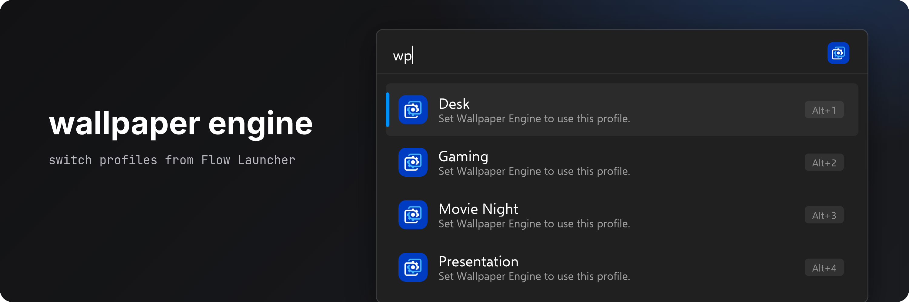

<!-- generated by readwright from docs/README.md.j2; edit the template, not this file -->


# Wallpaper Engine Profile Selector

Switch Wallpaper Engine profiles from Flow Launcher.

[](https://github.com/Garulf/Wallpaper-Engine-Profile-Selector/actions/workflows/tests.yml) [](https://github.com/Garulf/Wallpaper-Engine-Profile-Selector/releases/latest) [](https://github.com/Garulf/Wallpaper-Engine-Profile-Selector/releases/latest)

[](https://www.buymeacoffee.com/garulf) [](https://github.com/sponsors/Garulf)

## Usage

Type `wp` to list the profiles you saved in Wallpaper Engine, then press `Enter` to switch to one:

```
wp
```


Keep typing to filter the list by name:

```
wp night
```


If `config.json` lists more than one Windows account, for example after Wallpaper Engine was started once
as Administrator, you get the profiles of the account you are signed in with.

If the plugin can't find Wallpaper Engine, select the error result to open the plugin settings.

## Installation

### Flow Launcher

In Flow Launcher, type:

```
pm install Wallpaper Engine Profile Selector
```


### Manual installation

Download `Wallpaper-Engine-Profile-Selector-<version>.zip` from the [latest release](https://github.com/Garulf/Wallpaper-Engine-Profile-Selector/releases/latest) and unzip it into
`%appdata%\FlowLauncher\Plugins`, then restart Flow Launcher.

Pre-releases of the next version are published from the open release PR on the
[releases page](https://github.com/Garulf/Wallpaper-Engine-Profile-Selector/releases) for testing. Flow Launcher won't offer them as updates.

## Configuration

Open **Settings → Plugins → Wallpaper Engine Profile Selector** in Flow Launcher:

| Setting | Default | Description |
| --- | --- | --- |
| Wallpaper Engine Directory | `C:\Steam\steamapps\common\wallpaper_engine` | The folder with Wallpaper Engine's `config.json` and executables |
| Executable | `wallpaper32.exe` | The executable that switches profiles. Pick `wallpaper64.exe` if you run the 64-bit version |

With Steam in its default location the directory is
`C:\Program Files (x86)\Steam\steamapps\common\wallpaper_engine`.

## Requirements

* Flow Launcher 1.17.0 or newer
* Python 3.8 or newer, which Flow Launcher can install for you
* Wallpaper Engine
